<div align="center">

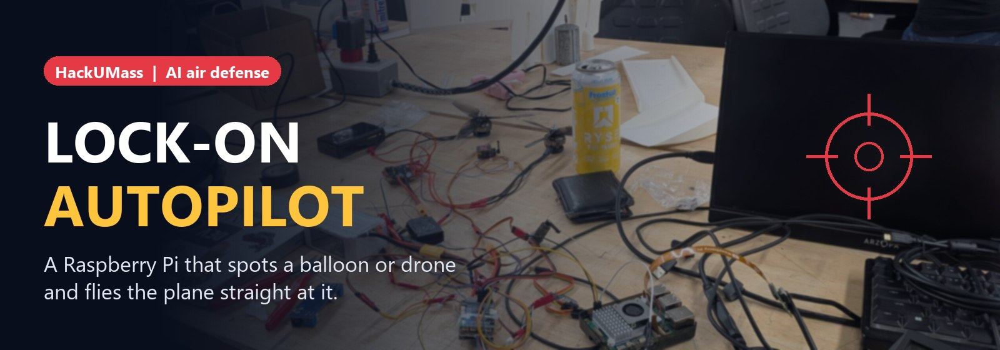

# Pi-Assisted Lock-On Autopilot for an INAV Mini-Plane

**Flip a switch on the radio, and a Raspberry Pi takes the stick: it finds a balloon or drone in the camera feed and flies an intercept course straight at it.**

[](https://hackumass.com)
[](https://www.python.org/)
[](https://www.raspberrypi.com/products/raspberry-pi-5/)
[](https://github.com/iNavFlight/inav)

[](https://docs.ultralytics.com/)
[](https://github.com/Tencent/ncnn)
[](https://opencv.org/)
[](https://edgetx.org/)
[](#how-the-pi-steers)
[](#dev-setup-laptop-no-pifc-needed)

[Demo](#-demo) · [Results](#-results-at-a-glance) · [How it works](#-how-it-works) · [Build](#-the-build) · [Setup](#dev-setup-laptop-no-pifc-needed) · [Runbooks](#whats-implemented-vs-what-you-still-have-to-physically-do)

</div>

---

## 🎯 What it does

A Raspberry Pi 5 + Camera Module 3 added to an existing SpeedyBee F405
Wing flying wing running **INAV 6.1.1**, so that flipping a transmitter
switch hands bank and pitch to the Pi, which detects a flying object
(balloon/drone) and flies an intercept course straight at it. The guidance
removes the plane's own roll and pitch from the camera line of sight using
the FC's attitude (gyro-extrapolated to the frame's exposure time) and
leads the target with proportional navigation, so a fast pass stays a
near-straight collision course instead of curving in late. Flipping the
switch off returns control to the pilot within 100 ms; if the Pi dies,
within about half a second. A 15 ft altitude floor is enforced whenever
lock-on is engaged. The Zorro shows the flight-mode text `HOR`
and beeps while a target is locked.

The original plan assumed Betaflight's MSP RC override. The bench
findings showed the board actually runs INAV 6.1.1, which doesn't include
that feature, so the Pi steers through INAV's programming framework
instead - see "How the Pi steers" below.

## 🎬 Demo

Bench tests at the hackathon. The Pi streams its camera to a laptop
browser with the detector's boxes drawn on top (`tools/web_preview.py`),
while we hold balloon and drone pictures up to the lens. Click any clip
for the full video.

<table>
  <tr>
    <td align="center" width="50%">
      <a href="docs/media/video/balloon-detection-test.mp4">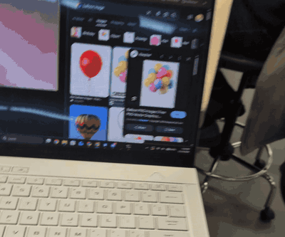</a>
      <br><b>Balloon detection</b><br><sub>YOLO11n on the Pi boxes a red balloon (<code>balloon 0.89</code>) at 640x480, ~13 fps</sub>
    </td>
    <td align="center" width="50%">
      <a href="docs/media/video/drone-detection-test.mp4">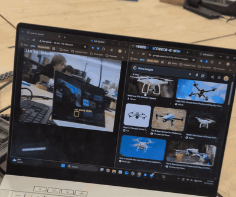</a>
      <br><b>Drone test</b><br><sub>Camera pointed at a screen of drone photos</sub>
    </td>
  </tr>
  <tr>
    <td align="center" width="50%">
      <a href="docs/media/video/phone-drone-test.mp4">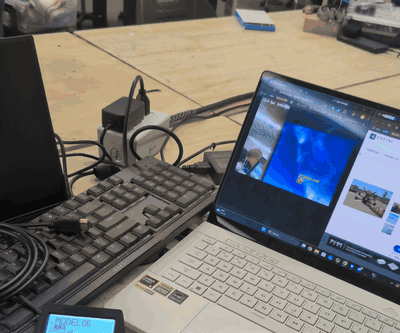</a>
      <br><b>Hand-held target</b><br><sub>A drone picture on a phone in front of the lens, with the RadioMaster Zorro in hand</sub>
    </td>
    <td align="center" width="50%">
      <a href="docs/media/video/pi-camera-live-feed.mp4">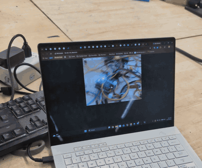</a>
      <br><b>Headless live feed</b><br><sub>Camera Module 3 streamed over Wi-Fi as MJPEG, no monitor on the Pi</sub>
    </td>
  </tr>
</table>

<p align="center">
  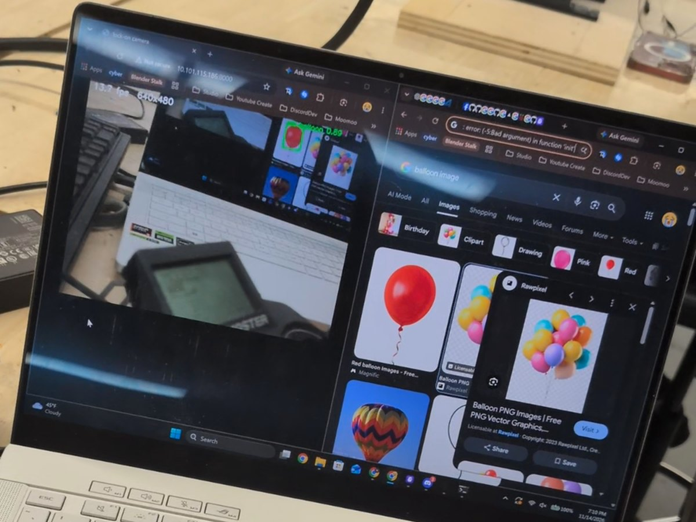
  <br><sub>Close-up: the green <code>balloon 0.89</code> box in the Pi's stream (left) around the red balloon on the right-hand screen.</sub>
</p>

## 📊 Results at a glance

| | Metric | Source |
|---|---|---|
| 🛩️ **Drone detection** | mAP50 **0.966**, precision 0.978, recall 0.902 on the held-out test split | [ML runbook](docs/runbook-task08-ml-detector.md#results) |
| 🎈 **Balloons against open sky** (v2 model) | a balloon found in **43 / 43** real sky photos, **0** false alarms on both sky test sets | [ML runbook](docs/runbook-task08-ml-detector.md#v2-balloons-against-the-sky-current-deploy-model) |
| 🔁 **Laptop to Pi parity** | NCNN Pi path reproduced **392 / 392** PyTorch detections (IoU ≥ 0.9) | [ML runbook](docs/runbook-task08-ml-detector.md#export-and-pi-package-done-for-v1) |
| 🎯 **Intercept simulator** | median miss **0.5 - 1.1 m** on a balloon ahead, 15-45 m/s, 150 ms latency | `python tools/intercept_sim.py` |
| 🕹️ **Pilot handback** | under **100 ms** on switch-off, about **0.5 s** if the Pi dies | [How the Pi steers](#how-the-pi-steers) |
| 🛡️ **Safety floor** | **15 ft** altitude floor while lock-on is engaged | `src/lockon/guidance/altitude_clamp.py` |
| ✅ **Software tests** | **175** pytest tests, no hardware needed | [Dev setup](#dev-setup-laptop-no-pifc-needed) |

## 🧠 How it works

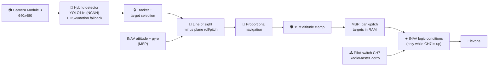

1. **See.** The Pi grabs frames from the Camera Module 3 and runs a
   YOLO11n model exported to NCNN. A color/motion detector covers frames
   the model misses, and a tracker bridges the gaps between detections.
2. **Aim.** Each detection becomes a line-of-sight angle. The plane's own
   roll and pitch, read from INAV over MSP and extrapolated to the frame's
   exposure time, are removed so the target stays put while the plane moves.
3. **Lead.** Proportional navigation turns the line-of-sight rate into
   bank and pitch commands that keep the plane on a collision course.
4. **Stay safe.** The altitude clamp limits the dive angle and pulls up
   before the 15 ft floor.
5. **Steer.** The Pi writes the targets into INAV's RAM. INAV applies them
   only while the pilot holds the lock-on switch and the Pi's heartbeat is
   fresh.

## 🔧 The build

<table>
  <tr>
    <td width="33%">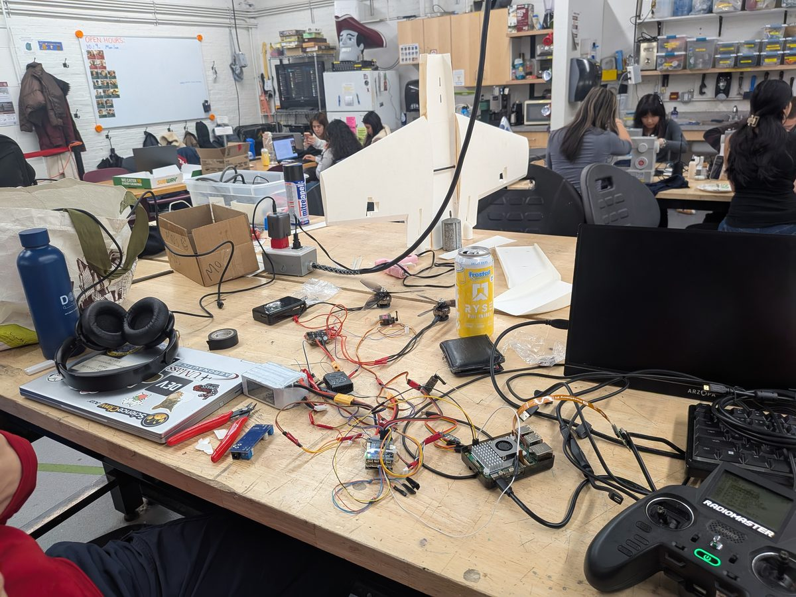</td>
    <td width="33%">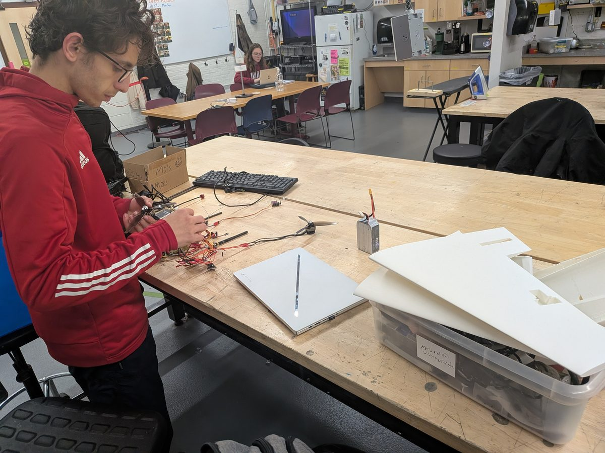</td>
    <td width="33%">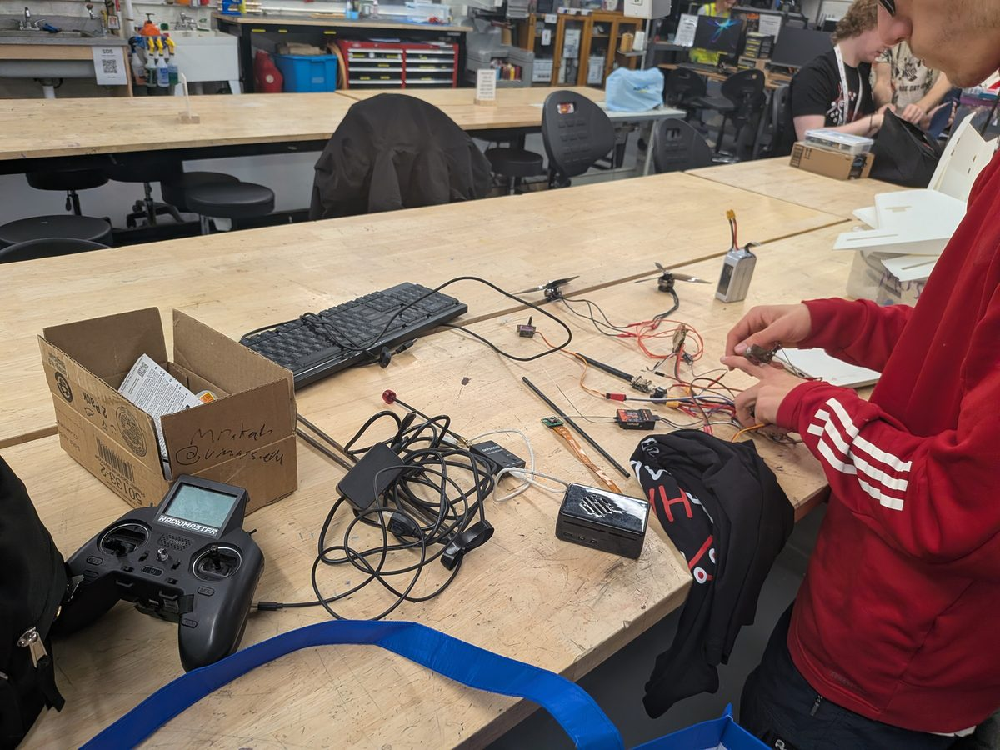</td>
  </tr>
  <tr>
    <td align="center"><sub>The full bench: foam wing, Pi 5, flight controller and radio</sub></td>
    <td align="center"><sub>Wiring the Pi to the flight controller's UART</sub></td>
    <td align="center"><sub>Bench integration with the RadioMaster Zorro</sub></td>
  </tr>
  <tr>
    <td width="33%">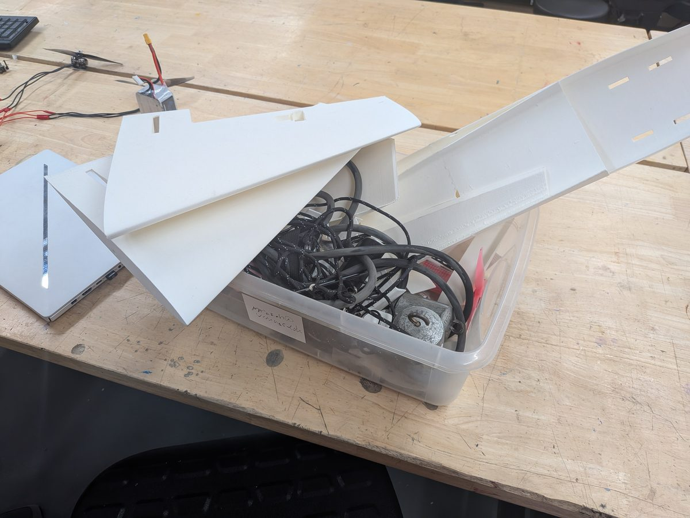</td>
    <td width="33%">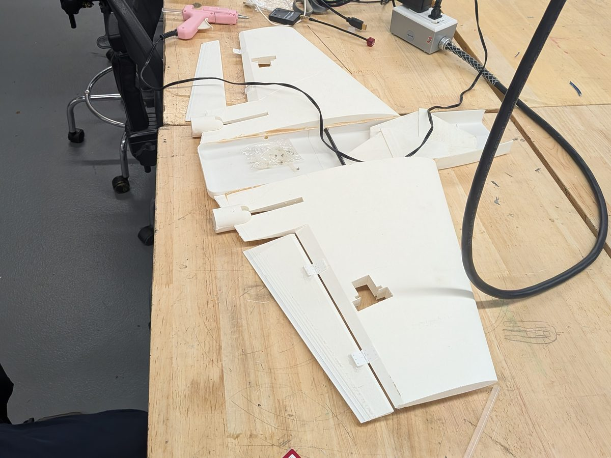</td>
    <td width="33%">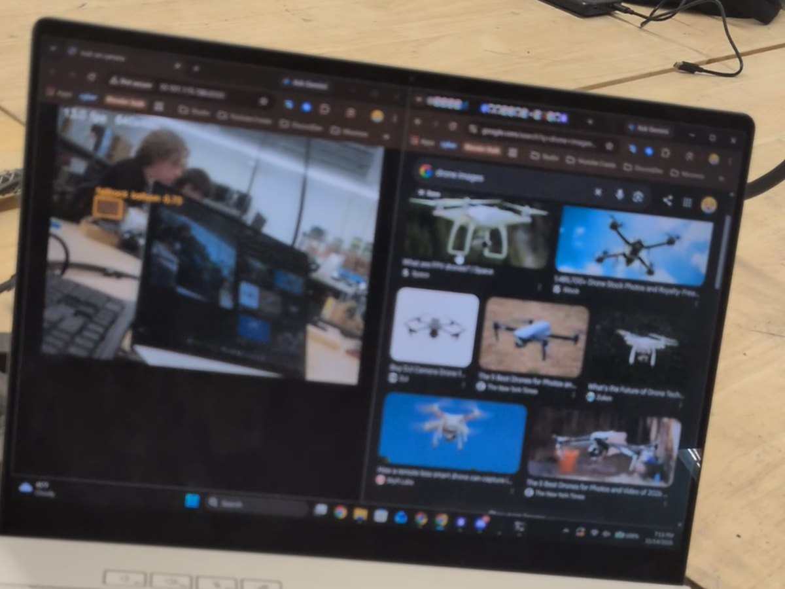</td>
  </tr>
  <tr>
    <td align="center"><sub>Foam airframe panels and parts</sub></td>
    <td align="center"><sub>Airframe build</sub></td>
    <td align="center"><sub>Drone detection bench test</sub></td>
  </tr>
</table>

### Hardware

| Part | Role |
|---|---|
| Raspberry Pi 5 | vision, guidance, MSP link |
| Raspberry Pi Camera Module 3 | 640x480 capture (standard or wide lens) |
| SpeedyBee F405 Wing running INAV 6.1.1 | flight controller, applies the Pi's bank/pitch targets |
| RadioMaster Zorro (EdgeTX) + ELRS | pilot control, CH7 lock-on switch, lock beep via `tools/edgetx/lockon.lua` |
| Foam flying wing | airframe |

---

## What's implemented vs. what you still have to physically do

This repo contains everything that is pure software: the MSP protocol
client, the vision pipeline (ML + fallback detection, tracking, target
selection), the guidance law, the altitude safety clamp, and the
integration controller wiring them all together - all unit tested
without needing the real Pi/FC/camera.

**Hardware setup, INAV CLI configuration, EdgeTX radio configuration,
and actual flight testing are physical actions nobody but you can
perform.** Each one has a step-by-step runbook in `docs/`:

| Task | What | Runbook |
|------|------|---------|
| 1 | Find free FC UART, confirm baro | `docs/bench-findings.md` (filled in) |
| 2 | Set up the INAV logic-condition link | `docs/runbook-task02-msp-override.md` |
| 3 | Wire the Pi, headless bring-up | `docs/runbook-task03-pi-bringup.md` |
| 4 | Camera sanity check | `docs/runbook-task04-camera-sanity.md` |
| 8 | Dataset/training/export for the ML detector | `docs/runbook-task08-ml-detector.md` |
| 11 | First real integration (props off) | `docs/runbook-task11-bench-integration.md` |
| 12 | Zorro indicator setup | `docs/runbook-task12-edgetx-indicator.md` |
| 13 | Props-on integration (secured) | `docs/runbook-task13-props-on.md` |
| 14 | Flight tests, then the balloon-pop test | `docs/runbook-task14-flight-tests.md` |

## Repo layout

<details>
<summary>Show the source tree</summary>

```
src/lockon/
  msp/
    codec.py            MSP v1 + v2 frames
    client.py           serial client (RC channels, altitude, raw requests)
    inav_logic.py       Task 2 - INAV logic-condition chain + run-time link
  guidance/
    attitude.py         aircraft attitude from INAV + gyro extrapolation
    altitude_clamp.py   15ft floor: predictive recovery + dive-angle limit
    intercept.py        pursuit + proportional-navigation guidance; speed est.
    sim.py              closed-loop intercept simulator (plane+camera+latency)
  vision/
    types.py            shared Detection type
    camera_model.py     pixel -> line of sight (azimuth/elevation) via attitude
    capture.py          Task 6 - Picamera2 wrapper (guarded import)
    fallback_detector.py Task 7 - HSV color + motion fallback
    ml_detector.py       Task 8 - NCNN inference wrapper (guarded import)
    ncnn_backend.py      Task 8 - real NCNN backend (Pi-only)
    tracker.py           Task 9 - CSRT/KCF wrapper (guarded import)
    selection.py         Task 9 - multi-target scoring
    hybrid.py            Task 9 - ML primary / fallback secondary / tracker bridge
  control/
    state_machine.py     Task 11 - LockState enum
    lock_on_controller.py Task 11 - wires everything into the INAV link

tools/            runnable scripts - bench tests, live demos, training,
                  benchmarking - see each script's docstring for usage
  inav_lockon_setup.py  prints the INAV CLI setup (Task 2)
  bench_logic_test.py   link bench tests (Tasks 2-3)
  edgetx/lockon.lua     radio beep script (Task 12)
docs/             hardware runbooks + bench-findings template
  media/          README photos, GIFs and demo videos
tests/            pytest unit tests for every pure-software module
```

</details>

## Dev setup (laptop, no Pi/FC needed)

```
py -m venv .venv
.\.venv\Scripts\python.exe -m pip install -r requirements-dev.txt
.\.venv\Scripts\python.exe -m pytest tests/ -v
```

All tests should pass; none require real hardware - every hardware
interface (serial port, camera, ML backend, tracker) is injected so
tests run against fakes. The guidance is also checked end-to-end in a
closed-loop simulator; `python tools/intercept_sim.py` prints a miss-
distance table across speeds, latencies and lenses.

## Training setup (laptop with NVIDIA GPU)

See `requirements-train.txt` and `docs/runbook-task08-ml-detector.md`
(datasets, filtering decisions, rebuild commands, v1 results).

The trained v1 model, already exported for the Pi, is in
`models/balloon_drone_v1/` (git-ignored; copy it to the Pi). Use
`--model-path models/balloon_drone_v1/ncnn_640x480` with the Pi tools.

## Pi setup

See `requirements-pi.txt` and `docs/runbook-task03-pi-bringup.md`.

## How the Pi steers

The ELRS receiver stays wired to the flight controller as before. A chain
of 14 INAV logic conditions (entered once from the CLI) applies the Pi's
target bank and pitch angles only while the pilot's lock-on switch (CH7)
is up, the Pi's heartbeat is fresh, and the Pi reports a target. The Pi
changes those values in RAM over MSP and never saves them. INAV runs the
chain at 10 Hz, so targets update 10 times a second in whole degrees,
capped at the INAV max angles (45 deg bank, 30 deg pitch). Throttle stays
on the pilot's stick. Details and the exact CLI lines:
`docs/runbook-task02-msp-override.md` and
`src/lockon/msp/inav_logic.py`.

## Known calibration items (flagged inline in code, not guessed at)

<details>
<summary>Show the calibration checklist</summary>

- Angle signs: `roll_sign`/`pitch_sign` in `LockOnChainConfig`
  (`inav_logic.py`) follow INAV's source (pitch target negative = nose
  up). Confirm on the bench (Task 2, step 4.3).
- Attitude/gyro signs: `InavSigns` in `guidance/attitude.py` assumes
  INAV's pitch is positive nose-down and the gyro signs match. Confirm
  with `python tools/check_attitude.py --port ...` before any lock-on
  flight (it tells you which sign to flip if one is wrong).
- Camera optics and tilt: the guidance needs the right focal length.
  `bench_integration_runner.py` reads the lens (standard vs wide) and the
  sensor crop from Picamera2 automatically; set `--mount-pitch-deg` if the
  camera points above the nose.
- Assumed airspeed: guidance assumes 30 m/s (`--speed-mps`) and refines it
  in flight from banked turns. A wrong estimate only scales the turn gain;
  the camera loop corrects the rest.
- Altitude: INAV measures it from where the board powered up, so power
  up at ground level at the field.
- Camera color order: `capture.py` requests Picamera2 `"BGR888"`, which
  yields RGB arrays. Confirm on the Task 4 monitor setup that a red
  balloon looks red (gets boxed by `live_overlay_demo.py --mode fallback`).
- Detector confidence threshold (0.40) and Pi input size (640x480 export,
  416x320 fallback): re-pick both on your own camera footage (Task 8
  runbook).
- `ColorMotionDetector`'s default HSV range targets a bright red/orange
  balloon - retune for your actual balloon color (Task 7).

</details>

---

<div align="center">
<sub>Built at HackUMass · Raspberry Pi 5 · INAV 6.1.1 · YOLO11n + NCNN</sub>
</div>
